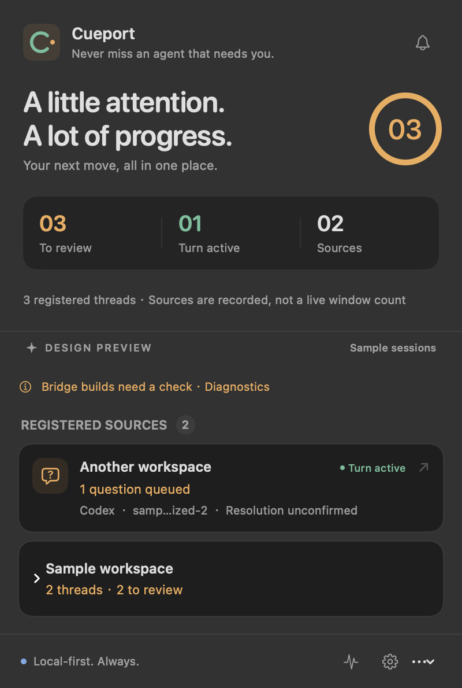

# Agent Attention Router

Never miss an agent that needs you.

A native macOS menu bar app for people using Codex in several iTerm2 windows,
tabs and split panes. Keep an attention list, receive system notifications and
return to the exact registered terminal without searching for it.

**Experimental preview.** Exact return requires the explicit connected launch
or resume workflow below. Ordinary unwrapped Codex sessions are not automatically
attached. This is not complete P0/ordinary-CLI support.

[中文](docs/README.zh-CN.md) · [Install and update](docs/install.md) ·
[Compatibility and acceptance](docs/compatibility.md) · [Quality evidence](docs/quality.md) · [Security](SECURITY.md) · [Third-party notices](THIRD_PARTY_NOTICES.md)



The screenshot contains synthetic records; it is a native sample render, not a
screenshot of accepted live monitoring.

## What it does

- Groups registered project sources and keeps execution independent of questions
  and approvals. An agent can work while several questions remain outstanding.
- Shows open registered sources on the main panel. Exited/closed sources leave
  the main panel; retained records and archive/restore stay in Diagnostics.
- Delivers generic question/approval/turn-stop reminders and returns only to a
  freshly verified, unique original iTerm session/process. A closed, stale or
  ambiguous target fails visibly without selecting another pane.
- Remembers the connected bridge for ordinary app reopens. Settings includes
  separate commands for new conversations and native conversation restoration.
- Lets you choose the native Codex file and run a bounded version check.
  Diagnostics distinguishes notification submission from verified return timing.
- Preserves sessions and running workers during an application update; an
  optional reviewed installer retains the previous application for rollback.

The app does not answer questions, grant approvals or send terminal input.
Reviewed, answered, cancelled and unknown remain different states. Some Codex
interaction lifecycles are unconfirmed; the app keeps that uncertainty visible.

## Requirements

| Component | Current scope |
| --- | --- |
| Mac | Apple Silicon; tested on macOS 27.2.1 |
| iTerm2 | 3.7.7 at `/Applications/iTerm.app`; normal Python API permission required |
| Codex | Native arm64 **0.169.0**, separately installed and initialized |
| Native backend | A working official Codex backend and normal login/network prerequisites |
| App signing | Local ad-hoc signature; no Developer ID or notarization |

macOS 14 is the source deployment target, not a tested support claim. Intel,
older macOS and other Codex/iTerm versions are not certified. Codex, iTerm2,
Python, Node and accounts are not bundled.

## Install and connect

Download a published package from [Releases](https://github.com/liyunhui0707/agent-attention-router/releases), extract it and keep
`Agent Attention Router.app` in `~/Applications`. See [installation](docs/install.md)
for verification, macOS first-open handling and update/rollback instructions.

1. Open the app → Settings → Your connection → Opening the app.
2. On a clean installation, choose **Set up connected bridge…**, then quit and
   reopen the app. Confirm **Current mode · Connected bridge**.
3. Use **Copy launch command** for a new conversation, or **Copy resume command**
   to choose an existing one. Run it in an iTerm2 Shell from your project folder.
   Complete native login/trust/API permission dialogs yourself.
4. If the default native dependency is missing, use **Choose native file…** and
   **Check file/version**. Select the arm64 binary named `codex`, rather than its
   shell/npm wrapper. This check does not start or repair its backend/login.
5. Enable app/system notifications. Focus and display-sharing policies may
   suppress alerts; the attention list remains available.

Keep existing custom data folders: installing the app elsewhere does not migrate
live session data. Existing workers load a changed helper after a natural manual
reconnection, not by being silently restarted.

## Privacy and limits

Stored metadata includes project basenames, session/request identifiers,
timestamps, execution/request states and original process/terminal identity.
The connected bridge relays full protocol bytes transiently in memory; it stores
no prompt, code, tool command, question body/options or transcript path. No
telemetry or cloud upload is implemented. Review [SECURITY.md](SECURITY.md).

A turn-stop reminder is an observation, not proof of final task completion.
Opening a notification marks it reviewed, not answered. Same-user processes are
within the local trust boundary. Missing dependencies and unsafe paths fail
rather than changing system permissions or starting managed Codex services.

## Build and test

With the macOS Swift 6 toolchain and Python 3 installed:

```sh
zsh scripts/test.sh
zsh scripts/build.sh release
```

The app is built under `build/Agent Attention Router.app`. Build/test commands
neither install Hooks nor change your Codex configuration. Native GUI, permission,
notification and Spaces acceptance require a logged-in Mac and remain separate
from automated tests. [Acceptance scope](docs/compatibility.md).

## Updates and feedback

Updates are manual; there is no automatic updater. Keep the previous app and
use the reviewed optional installer for app-only rollback. Never restore an old
session-data snapshot as part of an app rollback.

Use repository Issues for sanitized bugs. Report vulnerabilities privately through
[Security Advisories](https://github.com/liyunhui0707/agent-attention-router/security/advisories/new); do not post transcripts,
credentials or raw event payloads publicly.

MIT License. See [LICENSE](LICENSE).
